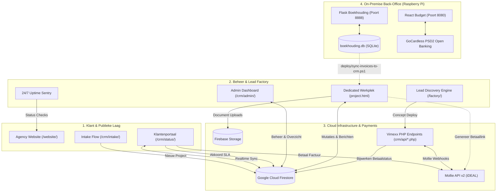

# REPO CONTEXT: Creation+Alt+Fix & Boekhoudings Ecosysteem

> **Doel van dit document:** Dit Markdown-bestand biedt een complete, geconsolideerde architectuuranalyse en contextuele blauwdruk van het software-ecosysteem rondom **Creation+Alt+Fix** en de bijbehorende **Boekhoudings Back-Office**. Het is specifiek geformatteerd als brondocument voor LLM's en AI-assistenten om direct contextueel begrip van de codebase te verkrijgen zonder overbodige bestandsanalyses.

---

## 1. Projectoverzicht & Doel

Het ecosysteem vormt de volledige operationele backbone van **Creation+Alt+Fix** (opgericht door Allard Veldman, Hoogezand) — een digitaal webbureau dat hoogwaardige, razendsnelle websites levert aan het MKB, gecombineerd met een eigen SaaS CRM-suite en een on-premise financiële administratie op een Raspberry Pi.

Het ecosysteem rust op twee primaire pijlers en een ondersteunende satellietlaag:

### 1.1 Front-Office: Creation+Alt+Fix SaaS CRM & Agency Suite
* **Locatie in workspace:** `c:\Users\Admin\Documents\GitHub\Websites\Creation-Alt-Fix`
* **Doel & Functionaliteit:**
  1. **Showcase Website (`/website/`):** Razendsnelle, framework-loze agency-website gebouwd met native ES Modules, 100% WebP-afbeeldingen en symmetrische tweetaligheid (NL/EN met 750 unieke sleutels).
  2. **Klant Intake Flow (`/crm/intake/`):** Interactieve intake-vragenlijst waarmee potentiële klanten hun wensen indienen; maakt direct een Firestore-project aan en triggert notificaties.
  3. **Klantenportaal (`/crm/status/`):** Multi-tenant statusportaal waarin klanten hun projectvoortgang volgen langs 5 fasen (Intake $\rightarrow$ Offerte $\rightarrow$ Design $\rightarrow$ Ontwikkeling $\rightarrow$ Livegang), offertes en SLA-contracten digitaal ondertekenen met cryptografische audit logging, facturen direct betalen via Mollie iDEAL betaallinks, en staging websites previewen.
  4. **Dedicated Admin Werkplek (`/crm/admin/` & `project.html`):** Volledig beheerstation voor projecten, klanten, taken (Kanban), communicatie, factuurgeneratie met 2027 abonnement-presets, en 24/7 uptime/DNS sentry monitoring.
  5. **Autonome Lead Discovery Factory (`/factory/`):** Pipeline die regionale bedrijven scant (Google Maps crawler), websitekwaliteit auditeert, AI-pitches en video-teasers genereert (via Playwright en FFmpeg) en conceptwebsites direct uploadt via FTPS naar Vimexx.
  6. **20-Punten Kwaliteitskeurmerk:** Opleverstandaard voor alle websites (AVG zero-tracking cookiebanner, interactieve Privacy/Terms modals, SEO Schema.org `@graph` met LocalBusiness en FAQPage snippets, honeypot formulierbeveiliging en WCAG-contrast).

### 1.2 Back-Office: Boekhoudings & Budget Suite (Raspberry Pi 2B)
* **Locatie in workspace:** `c:\Users\Admin\Documents\GitHub\Boekhoudings`
* **Doel & Functionaliteit:**
  1. **Zakelijke Boekhouding (`/Boekhouding`):** Python/Flask applicatie met een SQLite database (`boekhouding.db`), draaiend op een lokale Raspberry Pi 2 Model B (poort 8888, Tailscale IP `100.65.226.112`). Dit is de *fiscale single source of truth* voor opeenvolgende factuurnummers (`2026-xxx`), relaties, debet/credit journaalposten, grootboek, btw-aangifte (rubrieken 1a en 5b) en Mollie v2 payment-links.
  2. **Persoonlijke Boekhouding (`/Persoonlijke-boekhouding/vibe-check-budget`):** Modern React 19 + TypeScript dashboard met een Python API (`server.py`, poort 8080) voor realtime persoonlijke financiën, dagelijkse *safe-to-spend* berekeningen, potjes/reserves (auto, investeringen), en PSD2 Open Banking transactie-synchronisatie via GoCardless.
  3. **Operational Deploy & Backup Pipeline (`/deploy`):** PowerShell- en bash-scripts voor geautomatiseerde dagelijkse backups van de Pi databases, Nginx reverse proxy configuratie, en unidirectionele synchronisatie van goedgekeurde uitgaande facturen naar het CRM.

### 1.3 Client- & Conceptwebsites (Satellieten)
* **Locatie in workspace:** `c:\Users\Admin\Documents\GitHub\Websites/<ClientName>`
* **Doel & Functionaliteit:** Statische, supersnelle maatwerkwebsites voor MKB-klanten (o.a. *Vanderplaats*, *Doornbos Websites* [deholterij, remtheerd, lutjestee], *Stenekes Rioolspecialist*, *Besseling Installatietechniek*, *Bakkertje Sieg*, *Scholte Elektrotechniek*, *Stichting PompPop*). Deze sites worden gehost op Vimexx, volgen het 20-Punten Keurmerk en worden gedeployed via Vimexx FTPS of GitHub Actions.

---

## 2. Tech Stack & Dependencies

### 2.1 Creation+Alt+Fix (Front-Office)
| Laag | Technologie | Details & Versies |
| :--- | :--- | :--- |
| **Frontend Runtime** | Vanilla JavaScript (Zero-Build ES Modules) | Geen Webpack/Vite nodig in productie; native browser execution |
| **Opmaak & Styling** | Semantic HTML5 & Modern CSS3 | CSS Custom Properties (Design Tokens), Dark/Light Glassmorphism |
| **Cloud BaaS & Auth** | Google Firebase | Firebase Auth, Cloud Firestore (`mythical-cider-475118-e5`), Firebase Storage |
| **Backend Microservices** | Native PHP 8.x (`crm/api/*.php`) | Draait op Vimexx DirectAdmin; verwerkt Mollie webhooks (`flock`), ID token validatie via Google Identity Toolkit |
| **Lead Factory Tooling** | Node.js 20+ (ES Modules) | `basic-ftp` (^6.2.1), `playwright` (^1.63.0), `ffmpeg-static` (^5.3.0) |
| **Testing** | Node.js Native Test Runner (`assert`) | Zero external test dependencies (`tests/run-all-tests.js`), 164+ unittests over 14 suites |

### 2.2 Boekhouding (Zakelijke Back-Office op Pi)
| Laag | Technologie | Details & Versies |
| :--- | :--- | :--- |
| **Backend Framework**| Python 3, Flask 3.0.2, Werkzeug 3.0.1 | WSGI server met Gunicorn achter Nginx |
| **Database** | SQLite3 (`boekhouding.db`) | Lokale relationele database met foreign keys & triggers |
| **PDF Processing** | `pdfplumber` (>=0.11.0) | Extractie en analyse van inkomende facturen en pakbonnen |
| **Frontend UI** | Jinja2 Templates & Vanilla CSS | Donker AI theme (`style.css`), native vector inline SVG's |
| **Betalingen** | Mollie Connect API v2 | Directe generatie van payment links en QR-codes op PDF's |

### 2.3 Persoonlijke Boekhouding (Vibe-Check Budget op Pi)
| Laag | Technologie | Details & Versies |
| :--- | :--- | :--- |
| **Frontend Framework**| React 19.2.4, TypeScript 5.9.3 | Gebundeld via Vite 8.0.1 (code-splitting via `React.lazy`) |
| **Styling & UI** | Tailwind CSS v4.2.2 (`@tailwindcss/vite`), Framer Motion 12.38, Lucide React | Vloeiende micro-interacties en dark glassmorphism |
| **Datavisualisatie** | Recharts 3.8.1 | Gestapelde historische trends, donut grafieken vaste lasten |
| **Backend API** | Python Flask, Flask-CORS (`server.py`) | Poort 8080; in-memory caching gekoppeld aan `budget_data.json` |
| **Open Banking** | GoCardless Bank Account Data API | PSD2 koppeling voor realtime ING banktransacties en saldi |

### 2.4 Server & Hosting Infrastructuur
* **Raspberry Pi 2 Model B:** 32-bit ARM Cortex-A7, 1 GB RAM, Raspberry Pi OS Lite, Tailscale VPN IP `100.65.226.112`.
* **Nginx:** Reverse proxy met Gzip compressie (`gzip_comp_level 5`), rate limiting en statische asset caching (`Cache-Control: 1y`).
* **Systemd:** Services `boekhouding.service` (poort 8888) en `budget.service` (poort 8080).
* **Vimexx DirectAdmin Webhosting:** PHP 8.x runtime met FTPS en SSL voor de publieke CRM microservices en klantensites.

---

## 3. Mappenstructuur (Tree View)

```text
├── Boekhoudings/                                # ZAKELIJKE & PERSOONLIJKE BOEKHOUDING (Pi 2B)
│   ├── Boekhouding/                             # Zakelijke Flask boekhoudapplicatie (Poort 8888)
│   │   ├── app.py                               # Hoofdapplicatie: routes, SQLite helpers, BTW & Mollie logica
│   │   ├── boekhouding.db                       # Productie SQLite database (relaties, facturen, mutaties)
│   │   ├── documenten/                          # Opslagmap voor geüploade inkoopfacturen en bijlagen
│   │   ├── Factuur generator/                   # Standalone HTML/JS factuursjabloon en generator
│   │   ├── static/css/style.css                 # Donker thema stylesheet met vector SVG iconen
│   │   └── templates/                           # Jinja2 templates (dashboard, facturen, btw_aangifte, pdf)
│   ├── Persoonlijke-boekhouding/                # Vibe-Check Budget applicatie (Poort 8080)
│   │   └── vibe-check-budget/                   # React 19 + TypeScript + Vite frontend
│   │       ├── server.py                        # Flask API server met in-memory JSON cache
│   │       ├── gocardless_service.py            # GoCardless PSD2 Open Banking integratie
│   │       ├── budget_data.json                 # Lokale snapshot van budget- en spaargegevens
│   │       └── src/                             # React broncode (context, hooks, tabs, modals)
│   └── deploy/                                  # Operationele scripts & Pi beheer
│       ├── backup-pi.ps1                        # Downloadt dagelijks databases van Pi naar lokale PC
│       ├── sync-invoices-to-crm.ps1             # Synchroniseert Pi facturen naar Creation-Alt-Fix CRM
│       ├── deploy-to-pi.ps1                     # Deploys code naar Pi met verplichte pre-flight backup
│       ├── nginx.conf                           # Nginx vhost configuratie met poort 8888 en 8080 mapping
│       └── *.service                            # Systemd service unit files voor Linux
│
├── Websites/
│   ├── Creation-Alt-Fix/                        # SAAS CRM, KLANTENPORTAAL & AGENCY SUITE
│   │   ├── crm/                                 # Klantenportaal & beheerapplicatie
│   │   │   ├── admin/                           # Dedicated Admin Werkplek en management dashboard
│   │   │   │   ├── index.html                   # Hoofddashboard met KPI's, Leads, Projecten en Taken
│   │   │   │   ├── project.html                 # Dedicated Werkplek: 1-op-1 projectbeheer en facturen
│   │   │   │   ├── js/admin.js                  # Hoofdcontroller voor admin overzicht
│   │   │   │   ├── js/project.js                # Hoofdcontroller voor dedicated werkplek
│   │   │   │   ├── js/modules/                  # Admin modules (Kanban, Billing, 2027 Subscriptions, Factory UI)
│   │   │   │   └── data/pi-invoices.json        # Door Pi gesynchroniseerde factuurhistorie
│   │   │   ├── api/                             # PHP microservices (Mollie checkout, webhook, healthcheck)
│   │   │   ├── intake/                          # Klant intake formulier en onboarding flow
│   │   │   ├── js/                              # Gedeelde CRM runtime logica
│   │   │   │   ├── core/                        # Firebase wrapper, Schemas, Store en Toast feedback
│   │   │   │   ├── uptime-monitor.js            # 24/7 DNS, SSL en HTTP ping sentry engine
│   │   │   │   └── pdf-generator.js             # Client-side PDF builder voor offertes en facturen
│   │   │   └── status/                          # Multi-tenant klantenportaal (5-fasen, SLA, facturen)
│   │   │       ├── index.html                   # Klantenportaal single-page interface
│   │   │       └── js/status.js                 # Portaal controller en realtime Firestore listener
│   │   ├── factory/                             # Autonome Lead Discovery & Concept Factory
│   │   │   ├── discovery/                       # Bedrijvenscanner & Google Maps crawler
│   │   │   ├── generator/                       # AI Concept website generator & pitch builder
│   │   │   ├── deployer/                        # Vimexx FTPS upload engine
│   │   │   └── video/                           # Headless Playwright + FFmpeg video teaser renderer
│   │   ├── website/                             # Publieke showcase & agency marketing website
│   │   │   ├── index.html, projecten.html       # Statische HTML5 pagina's
│   │   │   ├── js/modules/translations-data.js  # Tweetalig woordenboek (NL/EN, 750 keys)
│   │   │   └── css/style.css                    # Zero-dependency CSS3 Design Tokens
│   │   ├── firestore.rules                      # Strikte Firestore NoSQL security & whitelisting regels
│   │   ├── storage.rules                        # Firebase Storage MIME-type en 10MB quota regels
│   │   └── tests/run-all-tests.js               # 164 geautomatiseerde regressietests over 14 suites
│   │
│   └── <ClientWebsites>/                        # Satelliet MKB- en portfolio-websites
│       ├── Vanderplaats/                        # Minimalistische contact hub & video teaser voor aannemer
│       ├── DoornbosWebsites/                    # 3 gerestaureerde sites met 20-Punten Keurmerk (De Holterij, etc.)
│       └── stenekesrioolspecialist/             # Rioolservice website met geautomatiseerde Vimexx FTP CI/CD
```

---

## 4. Architectuur & Dataflow



### 4.1 Routing & Pagina-interacties
* **`/website/`**: Statische agency-presentatie. Verwijst bezoekers via CTA's door naar de intakeflow of direct naar WhatsApp (`wa.me/31619135453`).
* **`/crm/intake/`**: Publiek formulier. Valideert invoer via client-side sanitatie en maakt een nieuw document aan in Firestore `projects`.
* **`/crm/status/index.html?id=<projectId>`**: Klantenportaal. Luistert realtime via `onSnapshot` naar het specifieke Firestore-document. Schakelt dynamisch tussen fasen (Intake, Offerte, Design, Livegang), toont facturen met iDEAL-knoppen, en verzorgt tweewegs communicatie via de chatbox.
* **`/crm/admin/index.html`**: Beheerdersdashboard. Toont omzetstatistieken, leads, actieve projecten, globale takenlijst en uptime status.
* **`/crm/admin/project.html?id=<projectId>`**: Dedicated Werkplek. Bevat alle projectdetails, interne notities, actielijsten, bestandsbeheer, SLA-status en de facturatie-suite (inclusief 2027 abonnementstransities en Mollie-link generatie).

### 4.2 State Management & Client Logica
* **Vanilla Micro-Store (`store.js` & `action-dispatcher.js`):** In het CRM wordt state beheerd zonder externe libraries. Een centrale observer-store houdt de actuele projectstatus, actieve filters en sessiestatus vast en stelt componenten in staat te reageren op mutaties via een event-dispatcher.
* **React Context (`BudgetContext.tsx`):** In Vibe-Check Budget beheert een dedicated React Context de berekeningen voor *safe-to-spend*, rekeningbronnen (`Betaalpas`, `Auto-rek`, `Buffer`) en historische maandsnapshots met volledige persistentie.

### 4.3 Database Schema's & Datamodellen
* **Google Cloud Firestore (`projects` collectie):**
  * `clientName`, `clientEmail`, `companyName`, `statusPhase` (1 t/m 5).
  * `proposalPrice`, `proposalScope`, `isAccepted`, `acceptedAt`.
  * `slaContract`: `{ planName, price, billingCycle, signedAt, signerName }`.
  * `subscriptionPlan2027`: `{ planName, price, confirmedAt, status }`.
  * `messages`: Array van `{ id, text, sender, role, timestamp }`.
  * `invoices`: Array van `{ invoiceNumber, amount, date, dueDate, isPaid, mollieLink }`.
  * `tasks`: Array van `{ id, text, completed, category }`.
* **SQLite Relational Schema (`boekhouding.db`):**
  * `relaties`: Bedrijfs- en persoonsgegevens, KvK, BTW-nummer, adres, e-mail.
  * `facturen`: `id`, `relatie_id`, `factuurnummer` (uniek, bijv. `2026-013`), `datum`, `vervaldatum`, `status` (`Concept`, `Verzonden`, `Betaald`, `Geannuleerd`), `type` (`Uitgaand`, `Inkomend`), `mollie_link`, `document_path`.
  * `factuurregels`: Gekoppeld aan `factuur_id`, bevat omschrijving, aantal, prijs, btw-percentage (21% / 9% / 0%).
  * `mutaties` & `mutatieregels`: Dubbel boekhouden (debet/credit) gekoppeld aan `grootboeken`.
  * `btw_aangiftes`: Historische kwartaalaangiften met opgeslagen JSON-payload.

### 4.4 Cross-System Data Synchronization Pipeline (Pi $\rightarrow$ CRM)
1. **Fiscale Bron:** Alle officiële factuurnummers worden uitsluitend aangemaakt in Pi Boekhouding (`boekhouding.db`). Hierdoor blijft de fiscale opeenvolging ononderbroken en geïsoleerd van publieke webservers.
2. **Geautomatiseerde Backup:** Een dagelijkse Windows Scheduled Task draait `deploy/backup-pi.ps1` om 21:00 via Tailscale SSH/SCP en downloadt `boekhouding.db` naar de lokale werkmap.
3. **Factuur Sync Script:** `deploy/sync-invoices-to-crm.ps1` voert een Python-extractie uit op de verse database. Het script berekent totalen exclusief/inclusief BTW per factuur en exporteert dit naar:
   - `crm/admin/data/pi-invoices.json` (voor backend en rapportages).
   - `crm/admin/js/modules/bookkeeping-data.js` (voor directe ES Module import in de admin werkplek).
4. **CRM Weergave:** Zowel de Dedicated Werkplek (`project.js`) als het Klantenportaal (`status.js`) lezen deze data uit, waardoor factuurhistorie, PDF-downloads en betaalstatussen direct zichtbaar zijn zonder handmatige invoer in het CRM.

---

## 5. Belangrijkste Componenten & Modules

### 5.1 Creation+Alt+Fix Kernmodules
* **`crm/js/core/firebase.js`**: Initialiseert de Firebase App en exporteert de `auth`, `db` (Firestore) en `storage` instances. Bevat fallback-detectie voor offline werking.
* **`crm/js/core/schemas.js`**: Garandeert uniformiteit tussen datavelden. Bevat defensieve normalisaties zoals:
  * `sanitizeProject(doc)`: Zorgt dat ontbrekende velden worden geïnitialiseerd met veilige defaults.
  * `sanitizeMessage(msg)`: Normaliseert heterogene berichtobjecten (`message`/`text`/`content`, `sender`/`role`, `timestamp`/`createdAt`).
  * `sanitizeInvoice(inv)`: Zorgt voor correcte afronding en valutaparsing.
* **`crm/js/core/store.js` & `action-dispatcher.js`**: Implementeert een minimalistisch pub/sub state-patroon voor UI-componenten in het admin-dashboard.
* **`crm/admin/js/admin.js`**: Hoofdcontroller voor het dashboard; laadt projecten, filtert tabellen, berekent omzet-KPI's en initieert de Kanban-weergave.
* **`crm/admin/js/project.js`**: Controller voor de Dedicated Werkplek; beheert specifieke klantendossiers, intake-antwoorden, interne memo's, en de facturatie-suite.
* **`crm/admin/js/modules/subscription-2027.js`**: Beheert de transitie naar de nieuwe 2027 tarievenstructuur (€95 / €150 / €165 / €175 / €350 / €500 per maand) met 1-klik voorstelgeneratie en statusregistratie.
* **`crm/status/js/status.js`**: Hoofdcontroller voor het Klantenportaal. Beheert de visuele fasentracker, PDF factuurdownloads, iDEAL links en interactieve chat.
* **`crm/status/js/modules/sla-signer.js`**: Handtekeningmodule voor SLA-contracten. Verifieert akkoord, genereert een cryptografische tijdstempel en slaat de audit-trail op in Firestore.
* **`crm/js/uptime-monitor.js`**: Autonome sentry die periodiek DNS-records, SSL-geldigheid en HTTP statuscodes van alle klantwebsites controleert en waarschuwingen verstuurt via webhooks.
* **`crm/js/pdf-generator.js`**: Client-side PDF render-engine voor offertes en facturen met officiële KvK- (`99986191`), BTW- (`NL005423147B16`) en IBAN-branding.
* **`factory/run-engine.js`**: Centrale orchestrator voor de lead discovery pipeline; stuurt de crawler, de enrichment en de video-generator aan.
* **`tests/run-all-tests.js`**: Zero-dependency kwaliteitsgate. Test syntaxis (`node --check`), XSS sanitatie, tabel- en datumberekeningen, Firestore rules synchronisatie en regressie-invariants (164 tests, 100% pass).

### 5.2 Boekhoudings Kernmodules
* **`Boekhouding/app.py`**: De complete Flask backend. Belangrijkste functionaliteiten:
  * Database migraties en initialisatie via `init_db()`.
  * Route `/facturen/mollie/genereer`: Maakt via Mollie API v2 een betaallink aan (`/v2/payment-links`, 21 dagen geldig) en koppelt deze aan de factuur.
  * Route `/btw-aangifte`: Berekent kwartaalomzet, verschuldigde BTW (21%/9%) en voorbelasting (rubriek 5b), met correcte uitsluiting van geannuleerde en conceptfacturen.
  * Route `/facturen/<id>/pdf`: Rendert een drukklare factuur via Jinja2 met dynamische vector QR-code voor mobiel bankieren.
* **`Persoonlijke-boekhouding/vibe-check-budget/server.py`**: Flask backend voor het budgetdashboard. Bevat in-memory caching tegen Micro-SD slijtage op de Pi en GoCardless bankintegratie.
* **`vibe-check-budget/src/context/BudgetContext.tsx`**: State-beheer voor rekeningsaldi (Betaalpas, Auto, Buffer) en geautomatiseerde maandafsluitingen.
* **`deploy/backup-pi.ps1`**: Robuust PowerShell backup-script. Downloadt databases met tijdstempel, verifieert bestandsgrootte en update de lokale Git-kopie.

---

## 6. Styling & Design System

### 6.1 Creation+Alt+Fix (Zero-Build CSS3)
Het platform maakt bewust géén gebruik van zware CSS-frameworks in productie. Alle styling is gebouwd op flexibele CSS Custom Properties (Design Tokens):

```css
:root {
  /* Primaire Kleuren */
  --bg-primary: #0a0b10;
  --bg-secondary: #12141f;
  --bg-card: rgba(22, 25, 40, 0.75);
  
  /* Accent- & Systeemkleuren */
  --accent: #6366f1;         /* Indigo Primair */
  --accent-hover: #4f46e5;
  --accent-purple: #8b5cf6;  /* Paars Verloop */
  --accent-emerald: #10b981; /* Succes / Betaald */
  --accent-rose: #f43f5e;    /* Fout / Geannuleerd */
  --accent-amber: #f59e0b;   /* Waarschuwing / Concept */

  /* Glassmorphism & Randen */
  --border-glass: rgba(255, 255, 255, 0.08);
  --border-glass-hover: rgba(99, 102, 241, 0.4);
  --backdrop-blur: blur(16px);
  --shadow-glow: 0 0 25px rgba(99, 102, 241, 0.25);
  
  /* Typografie */
  --font-family: 'Outfit', 'Inter', -apple-system, sans-serif;
}
```

* **Esthetiek:** Donkere "Cyber Glass" look met frosted-glass cards, neon borders bij hover, en vloeiende CSS transities.
* **Toegankelijkheid:** Voldoet aan WCAG AA-standaarden voor tekstcontrast; alle interactieve elementen zijn voorzien van duidelijke focus-ringen en unieke ID's.

### 6.2 Boekhouding (Zakelijk)
* Gestileerd via `Boekhouding/static/css/style.css`.
* Donker design met duidelijke status-badges: Groen (Betaald), Geel/Oranje (Openstaand), Rood (Geannuleerd), Grijs (Concept).
* Alle iconen zijn schaalbare, inline vector SVG's om afhankelijkheid van externe CDN's en "emoji tofu squares" op Chromium te voorkomen.

### 6.3 Vibe-Check Budget
* Gebouwd met **Tailwind CSS v4** (`@tailwindcss/vite`).
* Visuele kleurcodering per financiële rekening: Blauw (Betaalrekening), Amber (Auto-rekening), Paars (Sparen/Buffer/Bitvavo).
* Micro-animaties via **Framer Motion** bij het openen van modals en het bijwerken van saldi.

---

## 7. Configuratie & Omgeving

### 7.1 Environment Variables
> ⚠️ **Beveiligingswaarschuwing:** Deel nooit echte geheimen of tokens. Onderstaand overzicht bevat uitsluitend de *sleutelnamen* die nodig zijn voor het configureren van een nieuwe instantie.

#### Creation+Alt+Fix (`.env` in repository root):
```env
# Vimexx FTPS Deployment Credentials
FTP_SERVER=
FTP_PORT=
FTP_USERNAME=
FTP_PASSWORD=
FTP_REJECT_UNAUTHORIZED=

# DirectAdmin SMTP E-mailverzending
SMTP_HOST=
SMTP_PORT=
SMTP_USER=
SMTP_PASSWORD=

# Lead Factory Bridge Token (optioneel)
CAF_BRIDGE_TOKEN=
```

#### Boekhouding (`.env` op de Raspberry Pi onder `/home/raspberrypi2/Boekhouding/.env`):
```env
FLASK_SECRET_KEY=
MOLLIE_API_KEY=
```

#### Vibe-Check Budget (`budget_data.json` of OS environment):
```env
GOCARDLESS_SECRET_ID=
GOCARDLESS_SECRET_KEY=
```

### 7.2 Scripts & Commando's

#### Creation+Alt+Fix (NPM Scripts):
```bash
# Uitvoeren van de volledige geautomatiseerde testsuite (164 tests):
npm test

# Bouwen van een geaudit, gezuiverd distributiepakket met release-manifest:
npm run package

# Uitvoeren van de autonome Lead Discovery Factory (1 run):
npm run factory:run

# Factory laten draaien als background daemon:
npm run factory:daemon

# Genereren van een motion video teaser voor een concept:
npm run video:generate
```

#### Lokale Ontwikkeling & Testen:
```bash
# Lokale PHP server starten voor het CRM:
php -S localhost:8000 -t crm/

# Lokale Flask server starten voor Boekhouding:
cd Boekhoudings/Boekhouding
python app.py
# (of dubbelklik op start_boekhouding.bat)

# Lokale Vite ontwikkelserver starten voor Vibe-Check Budget:
cd Boekhoudings/Persoonlijke-boekhouding/vibe-check-budget
npm run dev
```

#### Raspberry Pi Deployment & Beheer (PowerShell):
```powershell
# Volledige database backup maken van de Raspberry Pi:
powershell -File "Boekhoudings\deploy\backup-pi.ps1"

# Synchroniseer verse Pi facturen naar het CRM:
powershell -File "Boekhoudings\deploy\sync-invoices-to-crm.ps1"

# Deploys code naar de Raspberry Pi (voert verplicht eerst een backup uit):
powershell -File "Boekhoudings\deploy\deploy-to-pi.ps1"
```

---

## 8. Richtlijnen voor AI-Assistenten (Do's & Don'ts)

1. **Raak `boekhouding.db` Nooit Direct Aan op Productie:** Voer altijd eerst `backup-pi.ps1` uit vóór een deployment of migratie.
2. **Respecteer de Factuurnummering Baseline:** Facturen worden chronologisch en aansluitend genummerd in Pi Boekhouding (bijv. `2026-013`). Genereer nooit willekeurige factuurnummers in het CRM die buiten de reeks vallen.
3. **Behoud de Firestore Security Whitelist:** Als je een nieuw veld introduceert in het klantenportaal dat de klant kan wijzigen, **moet** dit veld worden opgenomen in `isValidClientUpdate()` binnen `firestore.rules`.
4. **Tweetaligheid Handhaven:** Elke nieuwe UI-tekst in het CRM moet worden toegevoegd aan zowel `nl` als `en` in `crm/status/js/modules/translations.js`.
5. **Zero-Regression Testplicht:** Draai na elke wijziging in `Creation-Alt-Fix` altijd `npm test` en zorg dat alle 164 tests 100% slagen.
